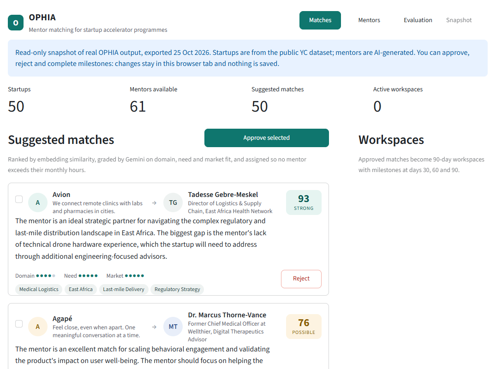
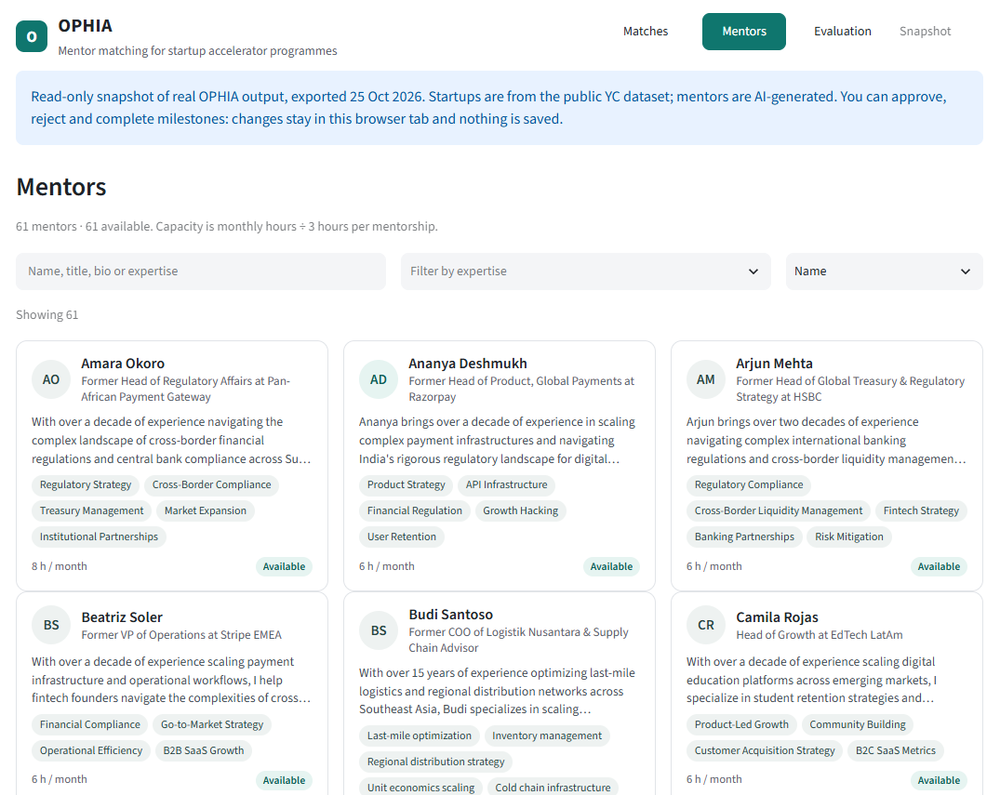
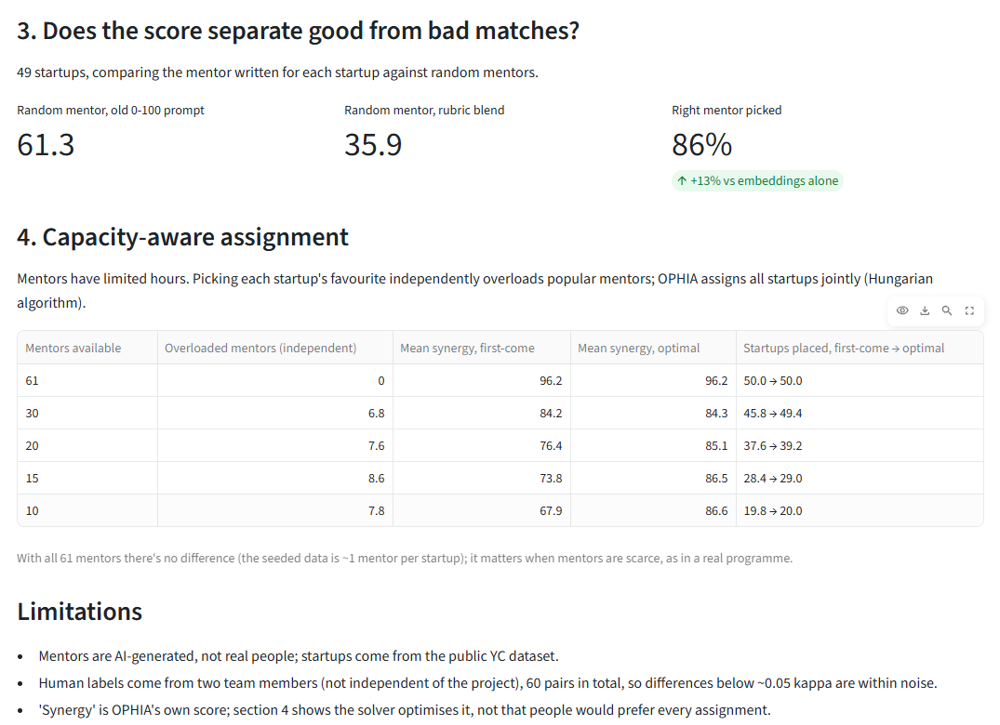
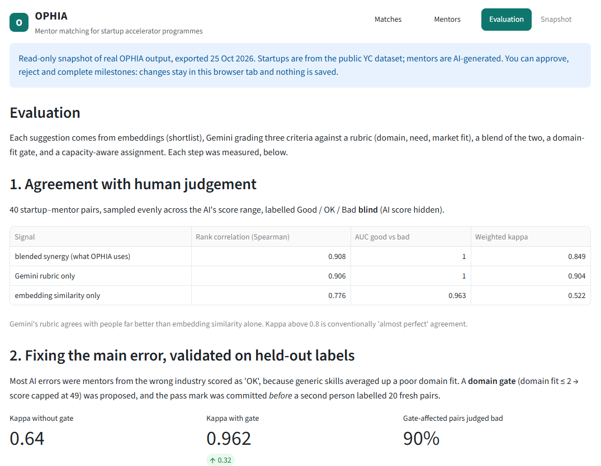

<div align="center">

# OPHIA

**AI mentor matching for startup accelerators: match, explain, approve, track.**

[](https://github.com/hhkismail/OPHIA-AI-Startup-Mentor-Matching-Platform/actions/workflows/ci.yml)


[**Live demo**](https://ophia-mentor-match.streamlit.app/) ·
[**Case study**](docs/CASE_STUDY.md) ·
[Evaluation](#results) ·
[Run it locally](#getting-started)



</div>

Built at **GDG KL Build With AI 2026 (MyHack)** for the Cradle Fund challenge *"Automating
Ecosystem Linkages Instead of Manual Coordination"*. Not affiliated with Cradle Fund.

**My role.** Team role was Backend & State Machine. At the hackathon I built the embedding
pipeline, the AI matching engine and the FastAPI backend. Afterwards I rebuilt the project
on my own fork: lifecycle state machine, auth, capacity-aware assignment, evaluation
against human labels, tests and CI, and deployment.

<details>
<summary><b>Table of contents</b></summary>

- [Inspiration](#inspiration)
- [What it does](#what-it-does)
- [How it works](#how-it-works)
- [Results](#results)
- [Challenges and what I learned](#challenges-and-what-i-learned)
- [Getting started](#getting-started)
- [API](#api)
- [Tests](#tests)
- [Roadmap](#roadmap)
- [Team](#team)

</details>

## Inspiration

Accelerator administrators match startups to mentors by hand: read every profile, guess a
fit, email both sides, set up a shared folder, book a kick-off, then chase progress.
Nothing is reused between cohorts, and nobody can say whether the matches were any good.

## What it does

- 🔎 **Suggests a mentor for every startup**, with a 0–100 score and a written reason
- 📏 **Grades each pair on a rubric**: domain fit, need fit and market fit, 1–5 each
- ⚖️ **Respects mentor capacity**: assigns all startups at once so no mentor exceeds their monthly hours
- ✅ **Puts a human in charge**: an admin approves or rejects; rejected pairs are never suggested again
- 🗓️ **Runs the mentorship**: approval starts a 90-day workspace with milestones at days 30, 60 and 90, and can send the intro email, create a Drive folder and book a Calendar kick-off

<details>
<summary><b>More screenshots</b></summary>




</details>

## How it works

```
 YC startups ─┐
              ├─► embed (Vertex AI) ─► Firestore
 mentors ─────┘                            │
                                           ▼
 ┌──────────── for every unmatched startup ─────────────┐
 │ 1. Shortlist  top-3 mentors by cosine similarity     │
 │ 2. Grade      Gemini rubric: domain / need / market  │
 │ 3. Blend      0.4 × similarity pct + 0.6 × rubric    │
 │ 4. Gate       wrong domain (≤ 2/5) → capped at 49     │
 └──────────────────────────┬───────────────────────────┘
                            ▼
 5. Assign   Hungarian algorithm across all startups, within each mentor's hours
                            ▼
 6. Review   admin approves / rejects (FastAPI, API key required)
                            ▼
 7. Run      90-day workspace; email, Drive and Calendar provisioned in the background
```

| Layer | Built with |
|---|---|
| Matching | Vertex AI `text-embedding-004`, Gemini `gemini-3.1-flash-lite`, SciPy (Hungarian algorithm) |
| Backend | FastAPI, Pydantic, explicit state machines, Firestore transactions |
| Frontend | Streamlit |
| Automation | Gmail, Google Drive and Google Calendar APIs |
| Quality | pytest, Firestore emulator, ruff, GitHub Actions |

## Results

Every scoring decision was measured, and the main fix was tested on held-out labels.

| Question | Result |
|---|---|
| Does the score separate good from bad mentors? | Random mentors score **36**/100 (the hackathon's 0–100 prompt gave them 61) |
| Does it pick the right mentor? | **86%** top-1 (embeddings alone 73%, hackathon prompt 76%) |
| Does it agree with people? | 40 blind-labelled pairs: Spearman **0.91**, weighted kappa **0.85** |
| Did the domain gate help? | Pre-registered, tested on 20 fresh pairs by a second labeller: kappa **0.64 → 0.96** |
| Does capacity-aware assignment help? | With 10 mentors: mean synergy **87** vs 68 first-come, no mentor overloaded |
| Is approval safe under concurrency? | 5 simultaneous approvals → exactly **1** workspace, tested on the Firestore emulator |



**Limitations.** Mentors are AI-generated, not real people. Human labels come from two team
members (60 pairs). Gmail/Drive/Calendar provisioning is tested against fakes only. Details,
method and full tables are in the **[case study](docs/CASE_STUDY.md)**.

## Challenges and what I learned

- **A plausible score can be meaningless.** The hackathon prompt rated random mentors 61/100.
  Measuring first, then switching to an anchored rubric, cut that to 36.
- **Don't grade an AI with its own answers.** Testing against mentors Gemini had generated was
  circular, so I built a blind labelling tool and measured agreement with people instead.
- **Fix the error you can see, then prove it on data you haven't seen.** Most mistakes were
  wrong-industry mentors scored "OK". I committed the fix and its pass mark *before* fresh
  labels existed, so the result couldn't be tuned after the fact.
- **Greedy matching breaks when resources are scarce.** Each startup taking its favourite
  overloaded 7–9 mentors; solving the assignment jointly fixed it.
- **Correctness lives in the database, not the UI.** Approval is a Firestore transaction with
  a deterministic ID, so double-clicks and retries can't create duplicate workspaces.
- **A test that can't fail proves nothing.** I re-introduced old bugs to check the tests caught
  them. One check found a real fail-open path in the auth, now fixed.

The full story, with numbers for each decision, is in [`docs/CASE_STUDY.md`](docs/CASE_STUDY.md).

## Getting started

**Demo mode (no keys, no cloud):**

```bash
cd ophia-frontend
pip install -r requirements.txt
streamlit run app.py
```

The dashboard uses the live backend if `OPHIA_API_URL` is set, otherwise
`snapshot.json` (real exported output, also what the public demo runs on), otherwise
built-in sample data.

<details>
<summary><b>Live mode (Vertex AI + Firestore)</b></summary>

1. Copy `.env.example` to `.env` in the repo root and fill it in. Never commit `.env`.
2. Google Cloud login: `gcloud auth application-default login`
   (or put a Firebase service-account key at `ophia-data/credentials/firebase-adminsdk.json`).
3. `pip install -r ophia-backend/requirements.txt -r ophia-frontend/requirements.txt`
4. Build the data (optional; `seed_db.py` embeds anything missing): `cd ophia-nlp && python embed_data.py`
5. Load Firestore: `python ophia-data/seed_db.py`
6. Google Workspace login (once; needs an OAuth client at
   `ophia-data/credentials/workspace-credentials.json`): `python ophia-data/workspace_trigger.py`
7. Backend: `cd ophia-backend && uvicorn app:app --reload` (interactive docs at `/docs`)
8. Frontend: set `OPHIA_API_URL="http://localhost:8000"` in `.env`, then `cd ophia-frontend && streamlit run app.py`

If you change `EMBED_MODEL`, re-run steps 4–5: vectors from different models can't be compared.

To refresh the public demo: `python ophia-frontend/export_snapshot.py` (reads Firestore,
no Gemini calls), then commit `ophia-frontend/snapshot.json`.

</details>

<details>
<summary><b>Project layout</b></summary>

| Folder | What it does |
|---|---|
| `ophia-nlp/` | `embed_data.py` builds startups (YC CSV) and generated mentors with embeddings. `ai_engine.py` shortlists, grades and scores. `assignment.py` is the capacity-aware optimiser. `eval_*.py` and `label_app.py` are the evaluation. |
| `ophia-backend/` | FastAPI server (`app.py`), lifecycle rules (`state_machine.py`), storage (`repository.py`: Firestore with transactions, or in-memory for tests), response schemas (`schemas.py`). |
| `ophia-data/` | `database.py` Firestore reads, `seed_db.py` loads data, `workspace_trigger.py` provisions email, Drive folder and Calendar kick-off. |
| `ophia-frontend/` | Streamlit admin dashboard. |
| `tests/` | Unit tests with fakes, and `integration/` tests on the Firestore emulator. |

</details>

## API

<details>
<summary><b>Endpoints and lifecycle</b></summary>

| Endpoint | What it does |
|---|---|
| `GET /api/linkages?limit=5&refresh=false` | Pending suggestions. An admin refresh suggests for all unmatched startups at once, assigned jointly within capacity |
| `POST /api/matches/{id}/approve` | Creates the workspace. Idempotent: approving twice returns the same workspace |
| `POST /api/matches/{id}/reject` | Optional `{"reason": "..."}` |
| `GET /api/matches?status=approved` | Every decision: the record of admin choices |
| `GET /api/workspaces` | All workspaces with milestones and provisioning status |
| `POST /api/workspaces/{id}/milestones/{day}/complete` | Next milestone; the last one completes the workspace |
| `POST /api/workspaces/{id}/cancel` | |
| `POST /api/workspaces/{id}/provision` | Retry email/Drive/Calendar after `partial`, `skipped` or `failed` |
| `GET /api/stats`, `/api/startups`, `/api/mentors`, `/api/health` | |

```
Match:         pending ──approve──► approved (creates a workspace)
                  └─────reject───► rejected (never suggested again)

Workspace:     active ──day-90 milestone done──► completed
                  └──────────cancel────────────► cancelled
               (milestones 30 → 60 → 90, in order)

Provisioning:  queued ──► succeeded | partial | skipped | failed ──retry──► queued
```

Every `POST`, and generating new suggestions, requires the admin key (`ADMIN_API_KEY`) in an
`X-API-Key` header, otherwise `401`. With no key configured, changes are disabled (`503`),
not left open. Lifecycle violations return `409` with the reason, unknown IDs `404`.

</details>

## Tests

```bash
pip install -r ophia-backend/requirements.txt -r ophia-frontend/requirements.txt -r requirements-dev.txt
ruff check .
pytest
```

239 tests: 230 unit tests (fakes for Firestore, Vertex AI and Google Workspace, so no
credentials or network) and 9 integration tests that run the production Firestore code on
Google's emulator. CI runs both on every push, on Python 3.11 and 3.12.

## Roadmap

- [x] Rubric scoring, evaluated against human labels
- [x] Domain gate, validated on held-out labels
- [x] Capacity-aware assignment
- [x] Lifecycle state machine with transactional approval
- [x] Admin auth, tests and CI, public demo
- [ ] Run Gmail / Drive / Calendar provisioning against real accounts
- [ ] Collect real approve/reject decisions to feed the evaluation loop
- [ ] Real mentor profiles instead of generated ones
- [ ] Dockerfile for one-command local setup

## Team

| Member | Hackathon role |
|---|---|
| Anna | Frontend & UI |
| Fitri | NLP Data Pipeline |
| Ismail | Backend & State Machine |
| Razin | Linkage Scoring & Data |

Startup data: the public Y Combinator companies dataset.
